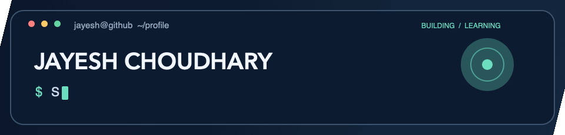

# Jayesh Choudhary

  

Software developer exploring Java, backend systems, and full-stack web apps.

## Featured repositories

1. **[QuickQuit](https://github.com/choudharyjayesh668/QuickQuit)** — A lightweight macOS utility that gracefully quits running apps with a keyboard shortcut.
2. **[J-Drive](https://github.com/choudharyjayesh668/J-Drive)** — A file organizer that uses a user's own Telegram channel as its storage layer.
3. **[JiluDB](https://github.com/choudharyjayesh668/JiluDB)** — A document-oriented database built from scratch in Java, with CRUD operations and file-based persistence.
4. **[Portfolio](https://github.com/choudharyjayesh668/Portfolio)** — My developer portfolio, featuring selected projects and the work I’ve been building. [Visit the portfolio](https://portfolio-rho-hazel-aip764oal1.vercel.app/).

## Tools I use

Java · Spring Boot · JavaScript · React · Node.js · Express · MongoDB · Git

## Find me

[LinkedIn](https://www.linkedin.com/in/jayesh-choudhary-8b7201360/) · [GitHub](https://github.com/choudharyjayesh668)
